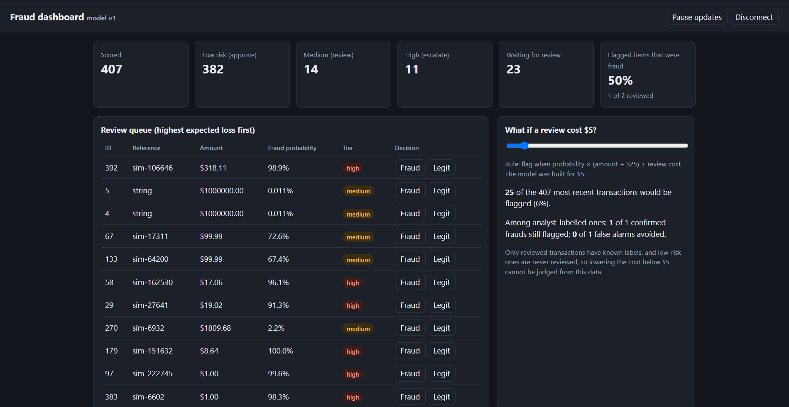
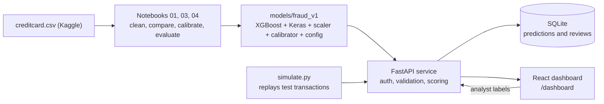
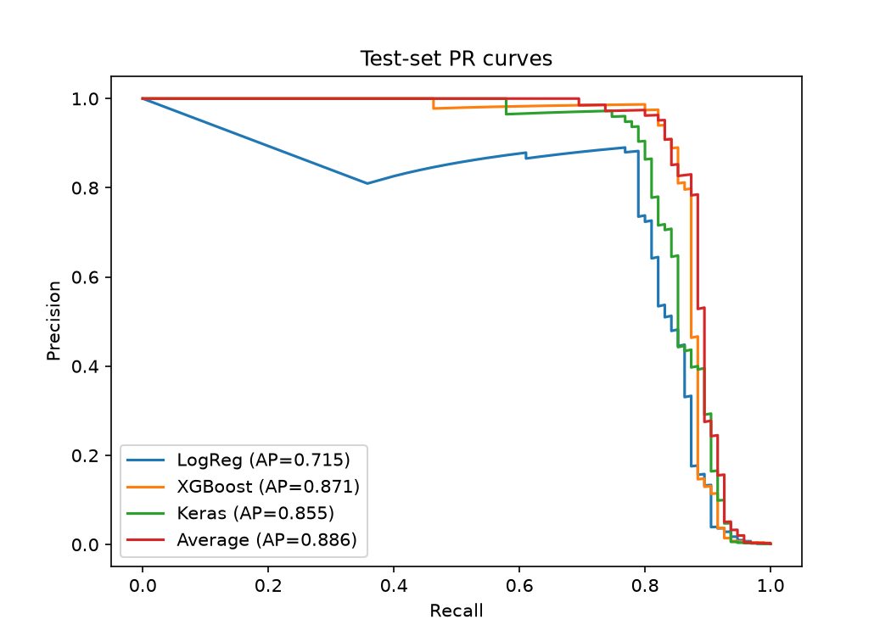
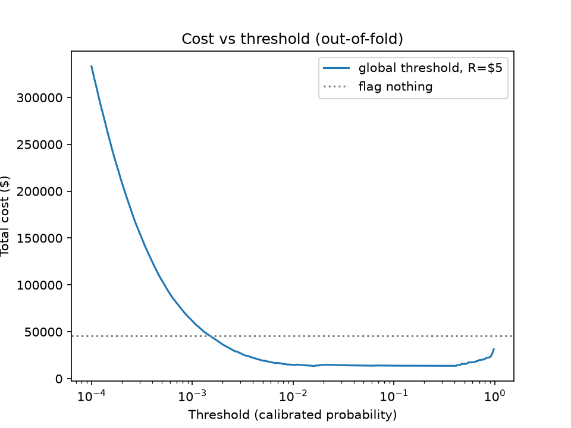
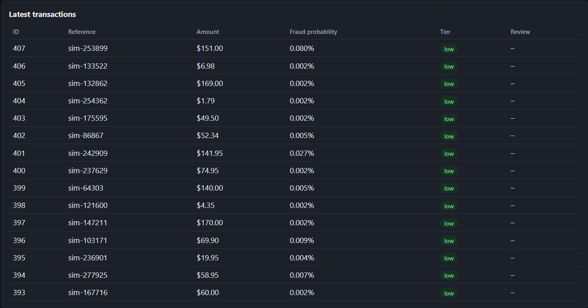

# AI Fraud detector System

A machine-learning system that scores credit-card transactions for fraud risk and routes each one to **approve**, **review** or **escalate**. It includes the full path from raw data to a working service: data cleaning, model comparison, probability calibration, cost-based decision rules, a tested FastAPI service, and a React dashboard with an analyst review loop.

> **Portfolio and learning project.** It uses a public, anonymized dataset from 2013. It is not connected to any real accounts and is **not a production fraud system**. See [Limitations](#limitations-and-responsible-use).



## Key results

Evaluated on a held-out test set that was scored exactly once, after every design decision was fixed.

| Model                                           | Test PR-AUC | 95% interval   | 5-fold CV mean |
| ----------------------------------------------- | ----------- | -------------- | -------------- |
| Logistic regression                             | 0.715       | 0.589 to 0.808 | 0.720          |
| XGBoost                                         | 0.871       | 0.802 to 0.933 | 0.832          |
| Keras neural network                            | 0.855       | 0.788 to 0.915 | 0.840          |
| **Average of XGBoost and Keras (served model)** | **0.886**   | 0.827 to 0.944 | 0.851          |

- The test set has only **95 frauds**, so the intervals are wide. XGBoost, Keras and their average overlap on the test set alone. The case for the ensemble rests on cross-validation, where it won all 5 folds.
- In a cost simulation (assumed $5 per analyst review and $25 extra loss per missed fraud), the amount-aware rule saved **84.7%** of fraud losses on the test set, against 78.9% for the best single threshold, using fewer flags (152 vs 196).
- Of the 152 transactions sent to a person, 41 were in the "high" tier (all 41 were fraud) and 111 in "medium" (42 were fraud). 12 of 95 frauds (13%) slipped through as "low".

Costs and savings are simulation results under stated assumptions, not real-world numbers.

## What it does

1. **Scores** a transaction with an ensemble of XGBoost and a Keras neural network.
2. **Calibrates** the score so that a probability of 0.30 means roughly 30% fraud.
3. **Decides** using expected loss: flag when `probability × (amount + 25) ≥ review cost`. A $1,800 transaction at 2% risk gets reviewed; a $5 one at the same risk does not.
4. **Routes** it to a tier: _low_ (approve), _medium_ (review queue) or _high_ (escalate, probability ≥ 0.90).
5. **Logs** every prediction to SQLite and lets an analyst label it, so reviewed labels can feed future retraining.

## Architecture



## Dataset

[Credit Card Fraud detector](https://www.kaggle.com/datasets/mlg-ulb/creditcardfraud) (Kaggle), collected by Worldline and the Machine Learning Group of ULB. It covers two days of transactions by European cardholders in September 2013.

- 284,807 transactions, 492 frauds (0.17%). After removing **1,081 exact duplicate rows**: 283,726 transactions, 473 frauds.
- Features: `Time` (seconds since the first transaction), `Amount`, and `V1` to `V28` (anonymized PCA components). Nothing like merchant, location or time of day is available, so explanations cannot be phrased in business terms.
- The data is **not included** in this repository. See the dataset page for its license and citation request.

## Approach

**Preparation.** Duplicates are removed before any split. The data is split 60/20/20 with stratification (train 170,235 rows / 284 frauds, validation 56,745 / 94, test 56,746 / 95). `Amount` is log-transformed, then `Time` and `Amount` are standardized with a scaler fit on the training set only.

**Models.** Logistic regression (balanced class weights) and XGBoost (300 trees, depth 4) as baselines, a Keras network (64 and 32 units, dropout 0.3, output bias initialized to the log fraud odds), and the mean of the XGBoost and Keras probabilities.

**Evaluation.** Because only 0.17% of transactions are fraud, accuracy is meaningless. The main metric is PR-AUC (average precision). Models are compared with stratified 5-fold cross-validation on train plus validation (378 frauds), and test-set uncertainty is shown with bootstrap intervals. Scalers and calibrators are fit on training data only.

**Calibration.** Out-of-fold scores were systematically too low (observed fraud rates were 1.4 to 2.9 times the predicted rates in the low and middle bins). Platt scaling, fit on out-of-fold scores, was chosen over isotonic regression by cross-validated log loss (0.00250 vs 0.00260, raw 0.00274).

**Decisions.** Instead of a fixed 0.5 cutoff, each transaction is judged by expected cost. The review cost ($5) and the extra loss per missed fraud ($25, standing in for chargeback fees and customer harm) are explicit, adjustable assumptions. A bootstrap on out-of-fold data showed the amount-aware rule matched or beat a threshold tuned on the same data in 5 of 6 cost scenarios.

## Detailed results



**Cost on the test set** (review cost $5, extra loss per miss $25):

| Rule                                                  | Cost    | Fraud loss saved | Flagged | Precision | Recall |
| ----------------------------------------------------- | ------- | ---------------- | ------- | --------- | ------ |
| Flag nothing                                          | $15,348 | –                | 0       | –         | –      |
| Single threshold (0.0169, chosen on out-of-fold data) | $3,236  | 78.9%            | 196     | 0.43      | 0.90   |
| Amount-aware tiers                                    | $2,347  | 84.7%            | 152     | 0.55      | 0.87   |

The amount-aware rule saved $889 more than the single threshold (95% interval $43 to $2,474), which is a modest edge, consistent in direction with the out-of-fold result.



**Risk tiers**

| Tier            | Test transactions | Frauds among them | Out-of-fold fraud rate |
| --------------- | ----------------- | ----------------- | ---------------------- |
| Low (approve)   | 56,594            | 12                | 0.03%                  |
| Medium (review) | 111               | 42                | 24%                    |
| High (escalate) | 41                | 41                | 98.7%                  |

**Calibration.** Platt scaling reduced test log loss from 0.00250 to 0.00233. Mid-range scores still understate risk on the test set (for example, 0.05 to 0.2 predicted 0.08, observed 0.25), though those bins hold only 6 to 24 transactions.

## API

FastAPI service in `app/`. Interactive docs are at `/docs` once it is running.

| Endpoint                         | Purpose                                                                                 |
| -------------------------------- | --------------------------------------------------------------------------------------- |
| `GET /health`                    | Status, model version and decision rules (no key needed)                                |
| `POST /predict`                  | Calibrated probability, tier and action for one transaction                             |
| `POST /predict/batch`            | Up to 1,000 transactions at once                                                        |
| `POST /explain?top_k=5`          | Top features pushing the score up or down (TreeSHAP, XGBoost half of the ensemble only) |
| `GET /transactions`              | Logged predictions, filterable by tier and review status                                |
| `POST /transactions/{id}/review` | Store an analyst label (`fraud` or `legit`)                                             |
| `GET /stats`                     | Counts per tier and review progress                                                     |
| `GET /dashboard`                 | The React dashboard                                                                     |

Example response from `POST /predict` (values illustrative):

```json
{
  "id": 392,
  "transaction_id": "sim-106646",
  "fraud_probability": 0.989,
  "expected_loss_ratio": 67.9,
  "tier": "high",
  "action": "escalate",
  "model_version": "v1"
}
```

**Security measures.** All endpoints except `/health` and the static page require an `x-api-key` header, compared in constant time; the server refuses to start without a key of at least 16 characters. Inputs are strictly validated (all 30 numeric fields required, no extra fields, non-negative bounded amounts, no NaN or infinity, batch size limited). The dashboard is served with a Content-Security-Policy that restricts connections to the same origin, and its CDN scripts are pinned to exact versions with Subresource Integrity hashes. The API key is never stored in a file.

## Dashboard

A single-page React app (no build step) served by the API at `/dashboard`. It shows tier counts, a review queue ordered by expected loss with **Fraud** and **Legit** buttons, a live feed of the latest transactions, and a "what if the review cost were different?" slider.



The traffic in the screenshots is **simulated** from held-out test transactions, enriched to 5% fraud so that small runs show interesting cases (the real rate is 0.17%).

## Getting started

**Requirements:** Python 3.10 or newer (developed on Windows with Python 3.14). The exact TensorFlow, XGBoost and scikit-learn versions used to build the saved model are recorded in `models/fraud_v1/config.json`; the API warns if yours differ.

```bash
git clone https://github.com/<Damiiner>/fraud-detecrot.git
cd fraud-detector
python -m venv .venv
# Windows: .venv\Scripts\activate        macOS/Linux: source .venv/bin/activate
pip install -r requirements.txt
```

**Data.** Download `creditcard.csv` from the [Kaggle dataset page](https://www.kaggle.com/datasets/mlg-ulb/creditcardfraud) into a new `data/` folder. It is needed for the notebooks and `simulate.py`, not for running the API with the included model.

**Retrain (optional).** Run the notebooks in order with _Restart & Run All_: `01_eda_and_models` (EDA, models, cross-validation, writes `data/oof_predictions.csv`), `03_calibration_and_threshold` (calibration and cost analysis), `04_final_evaluation` (scores the test set once and writes `models/fraud_v1/`). There is no `02`; that work was merged into `01`. Keras results can differ in the third decimal between runs.

**Run the API and dashboard.**

```powershell
# Windows PowerShell
$env:FRAUD_API_KEY = (python -c "import secrets; print(secrets.token_urlsafe(32))")
$env:FRAUD_API_KEY            # shows the key; you will need it to log in
python -m uvicorn app.main:app
```

```bash
# macOS / Linux
export FRAUD_API_KEY="$(python -c 'import secrets; print(secrets.token_urlsafe(32))')"
python -m uvicorn app.main:app
```

Wait for `Application startup complete`, then open http://127.0.0.1:8000/dashboard and enter the key.

**Generate traffic** in a second terminal (activate the venv and set the same key first):

```bash
python simulate.py                       # 200 test transactions
python simulate.py --seed 1 --n 500      # a different, larger set
python simulate.py --auto-review         # a pretend analyst labels the queue
python try_predict.py                    # minimal client example
```

**Troubleshooting**

| Symptom                                | Cause                                                                         |
| -------------------------------------- | ----------------------------------------------------------------------------- |
| `No module named 'app.main'`           | Files are in the wrong folder, or the terminal is not in the project root     |
| `RuntimeError: Set FRAUD_API_KEY`      | The variable is set per terminal window; set it in the one running the server |
| `401` from a script                    | The key in that window differs from the server's                              |
| Dashboard says it could not load React | No internet access to the CDN                                                 |

## Testing

```bash
python -m pytest
```

23 tests run against the committed model: authentication on every protected endpoint, input validation, single and batch consistency, prediction logging, the review flow and statistics, SHAP contributions that reconstruct the XGBoost probability, and the dashboard's security headers. I also confirmed the tests are meaningful by deliberately breaking authentication and logging and checking that they failed. The dashboard's behavior was checked separately in a simulated browser; that check is not part of this repository.

## Problems we ran into and what we learned

1. **Duplicate rows.** 1,081 identical rows could land in both training and evaluation data and inflate scores. They are removed before any split, and the notebooks assert the expected row and fraud counts.
2. **A result that would not reproduce.** An early XGBoost validation score of 0.898 turned out to be 0.777 on a clean run. After a kernel restart, the notebook showed another symptom: it reproduced the pre-deduplication numbers because the dedup cell sat after the split cell. The 0.898 most likely came from a model trained before deduplication and scored on a post-deduplication validation set, so it saw many of its own training rows. An early conclusion that "XGBoost clearly beats the neural network" was built on it and had to be withdrawn. **Fix:** a single linear notebook with dedup before the split, assertions on shapes and fraud counts, and _Restart & Run All_ as the gate before trusting any number.
3. **Class weights hurt the neural network.** With balanced weights (about 600 times on fraud), validation PR-AUC peaked after one epoch, and early stopping restored a barely trained model. With no weights and the output bias set to the fraud log-odds, the best epoch moved to 39 to 72 and mean PR-AUC rose from about 0.71 to 0.785. XGBoost was insensitive to weighting (0.777 to 0.793).
4. **One validation split could not separate the models.** With 94 frauds, differences of a few hundredths were noise. Switching to 5-fold cross-validation over 378 frauds changed the picture: Keras and XGBoost were tied, and their average was best in every fold.
5. **Raw probabilities were not probabilities.** Observed fraud rates ran well above predicted ones, so a calibration step was added and chosen by cross-validated log loss.
6. **A single threshold ignores money.** One cutoff treats a $5 and a $500 transaction identically. The amount-aware rule fixed that, and a bootstrap showed the benefit was real but modest, with one scenario reversed.
7. **Test-set discipline.** The review cost, extra loss per miss, tier boundary and model were all fixed before the test set was scored, and it was scored once.
8. **Setup pitfalls on Windows.** Files placed in the wrong folder (`No module named 'app.main'`), environment variables that only live in one terminal window, and notebook state that silently diverged from the notebook's text are all in the troubleshooting table above because they cost real time.

## Limitations and responsible use

- **Old, narrow data.** Two days of transactions from 2013, with PCA-anonymized features. Performance on current real-world data is unknown, and fraud patterns drift over time.
- **`Time` is not usable in production.** It is seconds since the dataset's first transaction. The model uses it, so a deployable version should drop it or replace it with time of day. Training a no-`Time` model is on the roadmap.
- **Small evaluation set.** 95 test frauds give wide intervals. Neural network results come from a single seed.
- **Assumed costs.** The $5 review cost and $25 extra loss per miss are assumptions that strongly affect recall. At $0 extra loss, the amount-aware rule catches only about 45% of frauds by count (the cheap ones), which is the right answer for that cost model but may not be acceptable in practice.
- **Mid-range calibration is imperfect**, and about 13% of test frauds scored low enough to be approved.
- **Explanations are partial.** `/explain` covers only the XGBoost half of the ensemble, and features are anonymized.
- **Human impact.** False positives inconvenience real customers. The system is a decision aid with a human reviewer in the loop, not an automatic judge. Fairness across customer groups cannot be assessed because no demographic information exists in the data.
- **Local-only security.** One shared API key, no HTTPS, no rate limiting, no per-user accounts. Do not expose it to the internet as is.

## Roadmap

- Docker Compose for the API and database, and CI that runs the tests
- A model without `Time`, and a second dataset with richer fields (merchant, category, timestamp)
- Per-transaction explanations in the dashboard
- A retraining job that uses analyst labels, and drift monitoring on the score distribution and reviewed precision
- An autoencoder anomaly score as a second signal
- Proper authentication, HTTPS, rate limiting and PostgreSQL

## Repository layout

```
fraud-detector/
├── app/
│   ├── main.py              # FastAPI app: endpoints, auth, validation
│   ├── scoring.py           # loads the artifact; scores and explains transactions
│   ├── db.py                # SQLite storage for predictions and reviews
│   └── static/dashboard.html
├── notebooks/               # 01_eda_and_models, 03_calibration_and_threshold, 04_final_evaluation
├── models/fraud_v1/         # XGBoost, Keras, scaler, calibrator, config.json
├── tests/                   # 23 pytest tests
├── figures/                 # plots used in this README
├── docs/                    # dashboard screenshots
├── simulate.py              # replays test-set transactions into the API
├── try_predict.py           # minimal client example
├── requirements.txt
├── pytest.ini
└── LICENSE
```

`data/` and `fraud.db` are created locally and are not tracked.

## License

[MIT](LICENSE)

## Acknowledgements

- Dataset: Worldline and the Machine Learning Group of ULB. Please see the [dataset page](https://www.kaggle.com/datasets/mlg-ulb/creditcardfraud) for its license and requested citations, including: Andrea Dal Pozzolo, Olivier Caelen, Reid A. Johnson and Gianluca Bontempi, _Calibrating Probability with Undersampling for Unbalanced Classification_, Symposium on Computational Intelligence and Data Mining (CIDM), IEEE, 2015.
- Built with TensorFlow/Keras, XGBoost, scikit-learn, FastAPI and React.
- Developed with assistance from Claude (Anthropic) for code generation and review. All reported numbers come from running the notebooks and tests in this repository.
